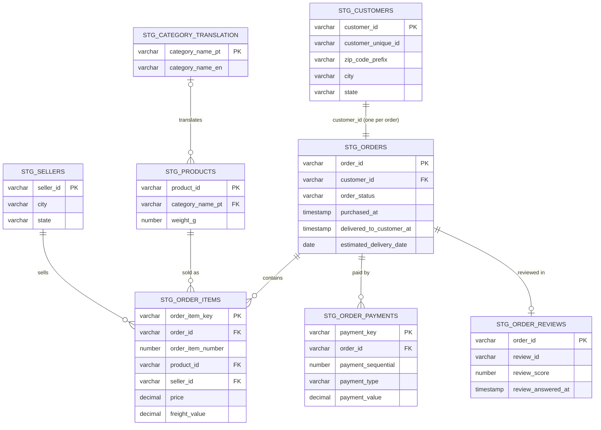
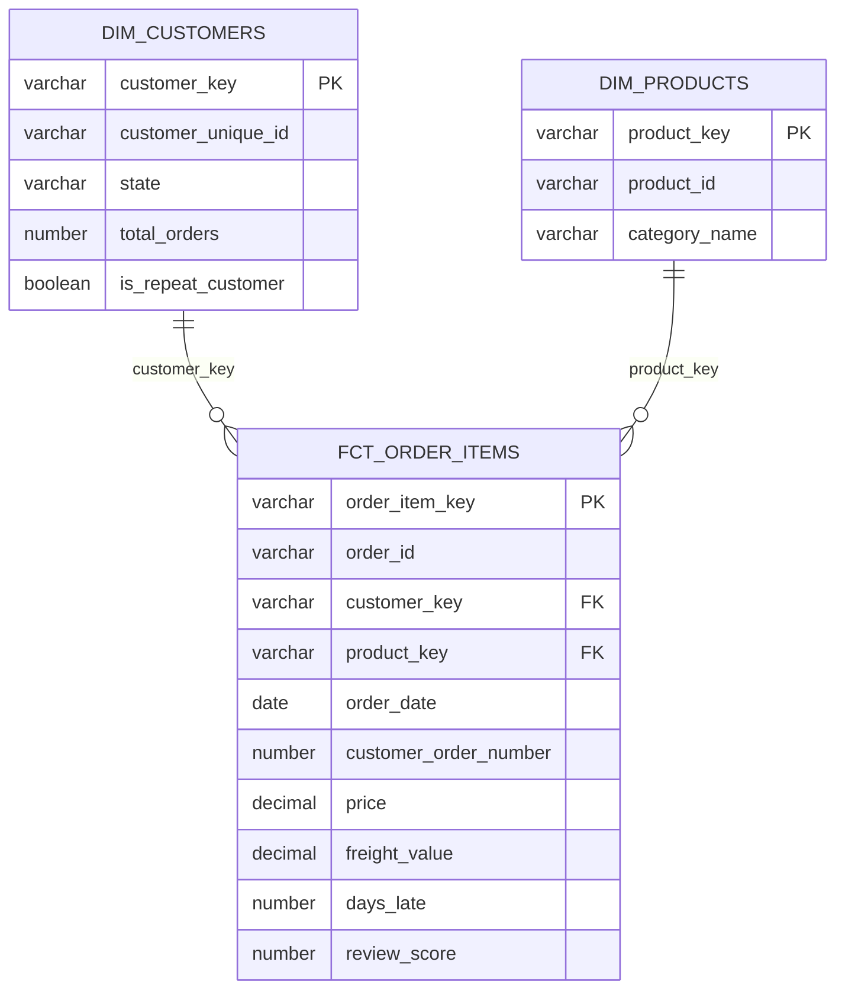

# Data model

## Layers

| Layer | Schema | Built as | Why |
|---|---|---|---|
| Raw | `olist.raw` | Tables (copy into) | Exact copy of the CSVs, all varchar, plus `_source_file` and `_loaded_at`. Nothing is lost or changed |
| Staging | `olist.staging` | Views | One model per source table: renamed, typed, deduplicated. Views cost nothing to store and always reflect raw |
| Marts | `olist.marts` | Tables | Star schema for analysis. Queried often, so stored as tables for speed |

## Staging: normalised model (3NF)

### Normalisation reasoning

Each staging model holds one kind of thing, keyed by one column, with no repeated groups. Order details live on orders, item details on items, and product details on products.

The main many-to-many relationship is orders and products: one order holds many products, and one product appears in many orders. `order_items` sits between them as a bridge table, with one row per item carrying the price and the seller. Orders and sellers are linked the same way.

Reviews were also many-to-many in the source. One review can cover several orders, and one order can have several reviews. I checked this rather than assumed it (every review and order pair is unique, so they aren't copies) and kept the latest review per order. That makes `order_id` the key, which suits the analysis because it works at order level.

There's one place I deliberately didn't fully normalise. Olist creates a new `customer_id` for every order, and the real person is `customer_unique_id`. Strict 3NF would split "the person" from "the address used on this order". I kept the source shape in staging and resolve the person in `dim_customers` instead.

Order items and payments have no single natural key, so they get a surrogate key built with `dbt_utils.generate_surrogate_key` from the order id plus the item or payment number.

## Marts: star schema

Staging is normalised so each fact is stored once and stays correct. Marts are flattened on purpose, so a business question needs one join instead of five. The fact table has one row per item sold.

I deliberately left payments out of the fact table. Payments are recorded per order and the fact is per item, so joining them would repeat each payment on every item in the order and double count revenue. Revenue comes from item `price` instead.

## Keys and constraints

Snowflake doesn't enforce primary, unique or foreign keys on standard tables, only not null. So I check every key with dbt tests:

- `unique` and `not_null` on every primary key, in staging and marts
- `relationships` tests on every foreign key (items, payments and reviews to orders, orders to customers, the fact to both dimensions)
- `accepted_values` on order status and review score

Duplicates are removed in staging with `qualify row_number() over (partition by <key> order by _loaded_at desc) = 1`, so reloading a file can't create duplicate rows.

`dbt build` runs 45 tests across both layers: 44 pass and 1 warns. The warning is 13 products whose category has no English translation. They're kept and shown in Portuguese rather than dropped.

## Data types

- IDs and zip codes stay as text, because zip prefixes can start with 0
- Dates and times are converted with `try_to_timestamp`, so a bad value becomes null and gets caught by tests instead of breaking the load
- Money is `decimal(10, 2)`, exact to the cent with no float rounding
- Counts and measurements are numbers